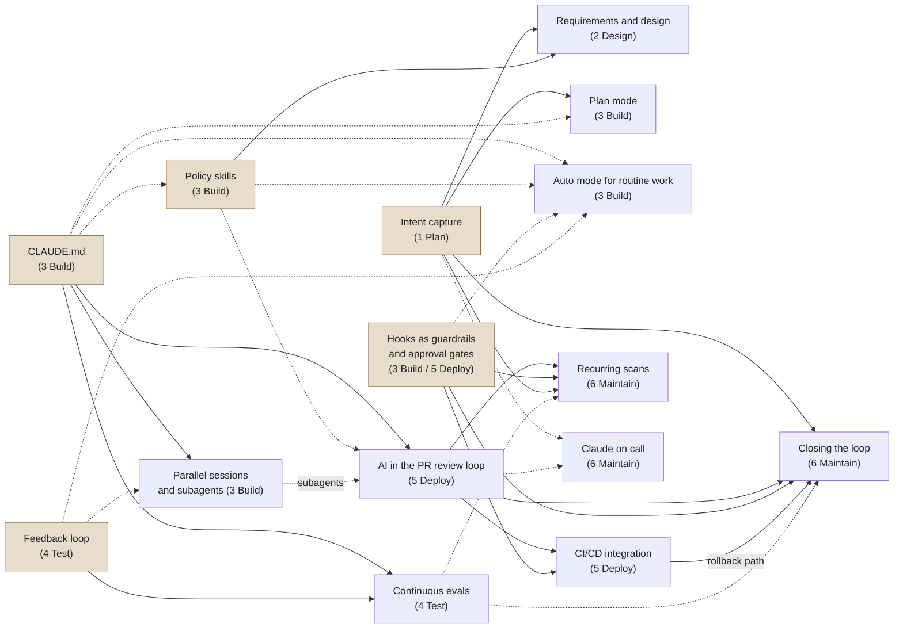

# Adoption: order of plays, bootstrap, rollout, right-sizing

Use this file when introducing the AI-native SDLC to a repository or a team: which plays to adopt first, how to bootstrap the repo with `sdlc.py init`, how to phase the rollout from hand-run prompts to a closed loop, and how to keep small work free of ceremony. The playbook lists plays by stage, but stage order is not adoption order. Start with plays that have no prerequisites, then adopt a play only once everything pointing into it is in place. The end state is a loop in which each accepted artifact fires the next step and human attention concentrates at the gates.

## Contents
- Dependency graph of the plays
- Dependency table
- Four-phase rollout
- Bootstrap procedure (`sdlc.py init`)
- Recommended GitHub settings
- First-week checklist
- Right-sizing: keep trivial work zero-ceremony
- Pitfalls

---

## Dependency graph of the plays

Solid arrows are the playbook's stated prerequisites; dotted arrows are "helps" (stated as helpful in the playbook, or inferred where marked in the table). Shaded nodes have no prerequisites: start with any of them.



## Dependency table

| Play | Requires | Helps | What this skill provides |
|---|---|---|---|
| Intent capture | — | — | `intent` mode; `sdlc.py new`; [intent.md](../assets/templates/intent.md), [intent-bug.md](../assets/templates/intent-bug.md) |
| CLAUDE.md | — | — | `/init`, then the block in [CLAUDE-verification.md](../assets/templates/CLAUDE-verification.md); `sdlc.py init --claude-md` adds the routing block |
| Policy skills | — (one policy with a named owner and a written source of truth) | CLAUDE.md | Pattern only: write your own skills in `.claude/skills/<name>/` |
| Feedback loop | — (one command each for test and build) | — | `verify_commands`, Stop hook, `sdlc-verifier` subagent, fix mode |
| Hooks as guardrails and gates | — (a written list of required approvals) | — | `sdlc.py init` installs `hooks.py` (or `sdlc.py package-plugin` for managed machines); `protected_paths`, `production_gate` in `.claude/sdlc.json` |
| Requirements and design | intent.md; brand, security, compliance, UX policies as skills | — | `spec` mode; [spec.md](../assets/templates/spec.md) |
| Plan mode | intent.md or spec.md | CLAUDE.md | `plan` mode; `plan-from-accepted`; plan guard; [plan.md](../assets/templates/plan.md) |
| Auto mode for routine work | — | Tuned CLAUDE.md, policy skills, hooks, a runnable test suite | Nothing to install; a settings decision per repo class (see references/governance.md) |
| Parallel sessions and subagents | CLAUDE.md | Feedback loop | `[P]` tasks in plan.md; subagents in [assets/agents/](../assets/agents/) |
| Continuous evals | CLAUDE.md, feedback loop | — | [run_evals.py](../scripts/run_evals.py), [eval-case.json](../assets/templates/eval-case.json), `agent-evals.yml` |
| PR review loop | CLAUDE.md | Policy skills (if passes enforce policy), defined subagents | [REVIEW.md](../assets/templates/REVIEW.md), `sdlc-reviewer`, `claude-review.yml`, `claude-mention.yml` |
| CI/CD integration | PR review loop, hooks as approval gates ("the gates must exist before automation accelerates anything through them") | — | `build-triage.yml`, `sdlc-artifacts.yml`, `runbooks` config |
| Closing the loop | intent.md format, PR review, hooks, a rehearsed rollback path from CI/CD | Continuous evals (each incident becomes an eval) | [bands.py](../scripts/bands.py), [bands.yaml](../assets/templates/bands.yaml), `control-bands.yml`, `sdlc-gate` |
| Recurring scans | PR review gate, hooks as approval gates, intent.md format | Continuous evals (each fixed vulnerability class becomes an eval) | `sdlc.py new --source scan` for findings wider than one PR |
| Claude on call (Claude Tag) | Not stated in the playbook | Intent format, PR review gate (inferred: small fixes arrive as PRs, larger ones as intent.md) | `diagnose` mode; `sdlc.py new --source incident` |

## Four-phase rollout

The playbook's progression: first you prompt each step by hand; the end state is a loop in which each accepted artifact fires the next gate. Move a play to the next phase only when its leading indicator (references/metrics.md) shows it is used and its lagging indicator isn't getting worse.

| Phase | What runs | Who starts each step | Exit criteria |
|---|---|---|---|
| 1. Manual prompts | Root plays by hand: intent with Claude, the spec prompt pasted by hand, plan mode, CLAUDE.md, one-command verification | A person, every time | 5+ changes taken intent → plan.md by hand; CLAUDE.md under a page with verify commands; a 4-week metrics baseline recorded |
| 2. Codified commands and skills | `sdlc.py init` hooks; policy skills with owners; REVIEW.md; subagents; the skill's `spec`/`plan`/`review` modes as the organization-level commands; 2-3 parallel sessions; eval suite run locally | A person, with one command | Each policy skill triggers on every phrasing in its trigger tests; 20-50 eval cases with a stable pass rate; AI review in shadow mode with an acceptable invalid-finding rate |
| 3. Triggered gates | `init --with-ci` workflows; branch protection and CODEOWNERS; required checks; the spec-on-intent job wired from the references/automation.md recipe (not installed by init); production gate wired to a real approval; per-environment autonomy tiers; rollback rehearsed | An event (merge, PR, comment, failure); humans review at gates | Time to first review in minutes; eval gate has blocked at least one regression; rollback exercised in staging within the last 30 days |
| 4. Closed loop | One metric under control bands; scheduled scans; on-call agent; incident → eval; sampling of automated approvals | A trigger with no person in the path | Breach → intent.md latency measured; incident findings reaching merged fixes; dismissals feeding band tuning |

Copy per phase:

```
Phase 1
- [ ] CLAUDE.md via /init, cut to a page; add the verification block
- [ ] One-command test/build/lint targets
- [ ] Run 5 changes through intent.md → spec.md → plan.md by hand
- [ ] Record baseline: python3 <skill-dir>/scripts/sdlc.py metrics; git/PR recipes from references/metrics.md
Phase 2
- [ ] python3 <skill-dir>/scripts/sdlc.py init --claude-md (hooks, subagents, REVIEW.md, CLAUDE.md routing block); on managed machines, the org plugin instead of project hooks (references/governance.md)
- [ ] One policy skill per owner; trigger-test it; owner signs off
- [ ] REVIEW.md tuned by the tech lead; AI review in shadow mode
- [ ] 20-50 eval cases from recent real tasks; python3 <skill-dir>/scripts/run_evals.py --threshold 0.9
Phase 3
- [ ] python3 <skill-dir>/scripts/sdlc.py init --with-ci; set secrets (ANTHROPIC_API_KEY or the cloud provider's); pin the Claude Code version
- [ ] Branch protection, CODEOWNERS, required checks, production environment (references/governance.md)
- [ ] production_gate.approval_check pointing at the environment approval or ticket API
- [ ] Wire the spec-on-intent trigger (references/automation.md) with the tier/gate/spec-exists guard
- [ ] Rollback as one command, rehearsed in staging; add it to "runbooks"
Phase 4
- [ ] bands.yaml for one metric with a stable baseline; bands.py self-test; control-bands.yml with the propose App (vars.SDLC_APP_ID, secrets.SDLC_APP_PRIVATE_KEY; never a code owner or bypass actor)
- [ ] Weekly scans on the most critical repos; first scan treated as the baseline
- [ ] Every incident fix adds an eval case
- [ ] Weekly risk-weighted sample of automated approvals
```

## Bootstrap procedure (`sdlc.py init`)

Run from the repo root, after the human agrees to the plan:

```
- [ ] python3 <skill-dir>/scripts/sdlc.py init --dry-run          # prints CREATE / MERGE / SKIP per action, changes nothing
- [ ] Review the action table with the human
- [ ] python3 <skill-dir>/scripts/sdlc.py init --claude-md        # add --with-ci only in Phase 3; drop --claude-md to paste the block yourself
- [ ] Edit .claude/sdlc.json: verify_commands, protected_paths, post_edit, production_gate.approval_check
- [ ] Open /hooks and confirm the four handlers are listed
- [ ] Smoke test (below), then commit the bootstrap as one PR
```

What `init` writes (idempotent; existing files are kept unless `--force` where noted):

| Target | Action |
|---|---|
| `.claude/sdlc.json` | Created if absent, with detected `verify_commands` (Makefile targets, package.json scripts, pytest config, go.mod) |
| `.claude/settings.json` | Hooks merged in (UserPromptSubmit, PreToolUse, PostToolUse, Stop → `scripts/hooks.py`); existing keys and hooks preserved; identical handlers deduped; paths written as `"$CLAUDE_PROJECT_DIR"/<skill path>`. Skipped when `init` runs from the plugin's copy of the skill (the plugin ships the hooks) |
| `.claude/agents/` | `sdlc-verifier.md`, `sdlc-reviewer.md`, `sdlc-gate.md` (existing kept unless `--force`) |
| `REVIEW.md` | Copied from the template if absent |
| `CLAUDE.md` | Without `--claude-md`: PROPOSE, and the `## How work is done here` routing block is printed. With it: the block is appended (CLAUDE.md created if absent). Skipped when the heading already exists |
| `.gitignore` | `.claude/sdlc-state/` appended if missing (local runtime state) |
| `changes/` | Created with `.gitkeep` |
| `.github/workflows/` | Only with `--with-ci`: the six workflows from [assets/github/](../assets/github/), existing files skipped |

Smoke test (proves the hooks fire before anyone relies on them):

```bash
python3 <skill-dir>/scripts/sdlc.py new hooks-smoke-test --tier bounded --title "Hook smoke test"
# Ask Claude to edit any source file: the plan guard must deny it with the next step.
python3 <skill-dir>/scripts/sdlc.py status --brief
python3 <skill-dir>/scripts/sdlc.py close <id> --status dropped
rm -r changes/<id>     # not committed; remove the trial folder
```

If the edit is not denied: the session started before `init` (restart it), `hooks_enabled` is false (that switches off every guard except the production gate), or managed `allowManagedHooksOnly` is blocking project hooks. For the last, ship the hooks as the org plugin (`sdlc.py package-plugin`, published to the org marketplace and force-enabled by managed `enabledPlugins`; see "Packaging the guardrail hooks as an org plugin" in references/governance.md) and rerun this test on a managed machine. With `self_protect` on, the agent cannot fix the config itself; a person edits `.claude/sdlc.json` or `.claude/settings.json`.

## Recommended GitHub settings

Minimum before Phase 3; the full list with reasons is in references/governance.md.

```
- [ ] Ruleset on the default branch: PR required, Code Owner review, dismiss stale approvals, require approval of the most recent reviewable push
- [ ] Required checks: CI, sdlc-artifacts (agent-evals for config paths)
- [ ] No bypass for the Claude GitHub App or github-actions
- [ ] "Allow GitHub Actions to create and approve pull requests" off
- [ ] CODEOWNERS for changes/**, CLAUDE.md, REVIEW.md, .claude/, .github/
- [ ] Environment "production" with release managers as required reviewers and self-review prevented
```

## First-week checklist

```
- [ ] Day 1: CLAUDE.md via /init, trimmed; verification block added; one-command test target works
- [ ] Day 1: sdlc.py init --dry-run, then init --claude-md (routing block in CLAUDE.md); smoke test passes
- [ ] Day 1, managed machines: sdlc.py package-plugin --out <dir>, publish to the org marketplace, force-enable through managed enabledPlugins; smoke test passes there too
- [ ] Day 2: first real change: intent.md with the originator; product owner approves at the gate
- [ ] Day 2-3: plan mode on that change; plan.md accepted; implement; verifier subagent; PR with pasted verification output
- [ ] Day 3: list the approvals the change process requires (with change management and compliance); map each to a gate or hook
- [ ] Day 4: pick the one policy enforced most inconsistently; draft it as a skill with its owner
- [ ] Day 5: record the metrics baseline; agree which tier each recent change would have been; adjust tier signals
```

## Right-sizing: keep trivial work zero-ceremony

Classify every request before doing anything and say it out loud: tier, reason, and "N artifacts, M gates". The human can override.

| Tier | Signals | Artifacts | Gates |
|---|---|---|---|
| `trivial` | typo, copy, formatting, comment, config hygiene, no behaviour change | none | merge only |
| `bounded` | one component, clear fix or small feature, no new data, auth or API surface, easy to revert; most bug fixes | short intent.md, plan.md (spec skipped automatically) | plan; plus intent when the intent is agent-written (ticket, incident, scan) |
| `standard` | new user-visible behaviour, several components, cross-team | intent.md, spec.md, plan.md | intent, spec, plan |
| `high-risk` | auth, payments, PII, migrations, infra, public API contracts, regulated code, hard to roll back | same, plus security and compliance passes and a rehearsed rollback | intent, spec (two approvals: product owner and tech lead or architect), plan (tech lead or architect) |

Why trivial work stays free: the plan guard applies only while there is an active change, and `sdlc.py new` refuses tier `trivial`. A typo fix creates no folder, no markdown and no gate; it still gets the merge gate, the unconditional protected-path, `self_protect` and production-gate guards, and the Stop hook, which blocks "done" in every session when a source edit came after the last verify run.

- **One-way ratchet.** Hidden complexity raises the tier (`sdlc.py raise-tier <id> <tier> --reason "…"`, logged as `TIER_RAISED`); then do the missing gates. A tier never goes down, because lowering it after work starts is how gates get skipped.
- **Skipping a stage deliberately** is allowed with a reason: `sdlc.py skip <id> design --reason "…"`. The audit log then shows evidence for every stage, including the ones not run.
- **`plan_guard_exempt`** (globs) is for paths that never need a plan, such as `docs/**`. Keep it short; every entry is an ungated path.
- **Bugs** are always at least `bounded`, with `--bug` (current / expected / unchanged behaviour): T1 of the approved plan is a failing test, committed before `fix-mode <id> on`.
- **Question budget.** At most five clarifying questions per artifact, one at a time, each with a recommended answer; record the rest as assumptions. Ceremony that the human has to answer is the most expensive kind.

## Pitfalls

- **Adopting by stage order.** Starting with Maintain before PR review and hooks exist automates changes past gates that aren't there.
- **Everything at once.** One play per team per phase is enough; let its indicator move before adding the next.
- **Ceremony for its own sake.** If trivial changes are producing markdown, the tier signals are wrong; fix them, don't tolerate the overhead.
- **Gates without enforcement.** A gate described in CLAUDE.md alone will be skipped under pressure. Each gate needs a hook, a CI check or a GitHub setting by Phase 3.
- **Skipping the smoke test.** Hooks that silently don't load look exactly like hooks that never fire.
- **Sessions outrunning review.** Add parallel sessions only while review keeps up; two or three is the starting point.
